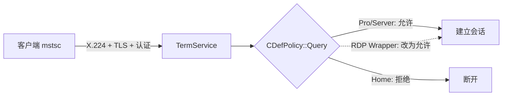

# 工作原理

## 家庭版到底缺了什么

Windows 的远程桌面分两半：

- **客户端**：`mstsc.exe`，所有版本都有。
- **服务端**：`TermService` 宿主进程 + `termsrv.dll`，家庭版**也有**，而且默认就在运行。

家庭版被拿掉的是**授权判定**，不是功能代码。连接建立时，`termsrv.dll` 会向 SKU 策略查询「本机是否允许被远程连接」，家庭版的答案恒为「否」，于是会话在授权阶段被丢弃。



所以这类方案的本质是**在内存里改写那个策略查询的返回值**，而不是「补上被删除的功能」。

## RDP Wrapper 的加载方式

`TermService` 启动时并不直接加载 `termsrv.dll`，而是读注册表决定加载哪个 DLL：

```
HKLM\SYSTEM\CurrentControlSet\Services\TermService\Parameters
    ServiceDll = %SystemRoot%\System32\termsrv.dll      ← 默认值
```

安装器把这个值改成：

```
    ServiceDll = C:\Program Files\RDP Wrapper\rdpwrap.dll
```

`rdpwrap.dll` 是 `termsrv.dll` 的**代理**：它先按配置修补真实 DLL 的内存映像，再把调用转交给真正的 `termsrv.dll`。因此：

- 磁盘上的 `termsrv.dll` 一个字节都没变（不触发文件完整性校验）；
- 补丁只存在于内存，**重启后由 `rdpwrap.dll` 重新施加**；
- 卸载 = 把 `ServiceDll` 改回默认值并重启服务。

## 三处补丁

配置表的每个版本段给出若干**文件偏移**，`rdpwrap.dll` 在服务进程内按偏移写字节。

### 1. `DefPolicyPatch` — 策略查询

定位 `CDefPolicy::Query` 中比较 SKU 策略的那条指令。反汇编形态大致是：

```asm
mov  r9d, [rdi+638h]      ; 当前值
cmp  r8d, r9d             ; 与请求值比较
jne  short ...
```

补丁把它改成「直接把 1 写进标志并跳走」，等于让所有策略查询返回「允许」：

```asm
mov  dword ptr [rdi+638h], 1
jmp  ...
```

### 2. `SingleUserPatch` — 单会话限制

家庭版/客户端 SKU 只允许一个会话；远程连入会要求本地注销。补丁把「是否允许接管」的判定强制为真。

### 3. `LocalOnlyPatch` — 来源限制

某些 SKU 把连接限制为「仅本机」。补丁把条件跳转改成无条件跳转。

### 4. `SLInitHook` + `SLInitFunc` — 策略全局变量

除了改写函数，`rdpwrap.dll` 还会挂钩 `CSLQuery::Initialize`，在初始化后覆写一组全局标志：

| 变量 | 含义 |
|---|---|
| `bServerSku` | 是否按服务器 SKU 行为运行 |
| `bRemoteConnAllowed` | 是否允许远程连接 |
| `bAppServerAllowed` | 是否允许多会话 |
| `bMultimonAllowed` | 多显示器 |
| `lMaxUserSessions` | 会话数上限（0 = 不限） |
| `bInitialized` | 初始化完成标志 |

这些是**数据地址**，不是代码地址。地址错了不会立刻崩，而是把内存写到别处——所以必须校验（见 [OFFSET-FINDING.md](OFFSET-FINDING.md)）。

## 注册表与防火墙

安装脚本除了放 DLL 和 ini，还会改：

| 位置 | 值 | 作用 |
|---|---|---|
| `...\Control\Terminal Server` | `fDenyTSConnections=0` | 打开「接受远程连接」 |
| `...\WinStations\RDP-Tcp` | `UserAuthentication=0` | 关闭 NLA，兼容更多客户端 |
| `...\WinStations\RDP-Tcp` | `SecurityLayer=2` | 强制 TLS |
| 防火墙 | 入站 3389 TCP+UDP | 放行 |

`UserAuthentication=0` 是兼容性取舍：NLA 要求客户端先做 CredSSP，一些老客户端和部分 App 会因此连不上。代价是认证前就暴露了登录界面，安全性略低。如果你的客户端都支持 NLA，可以改回 `1`。

## 会话模型

补丁不会把家庭版变成终端服务器。实际行为：

- 默认仍是**单会话**：远程连入会把本地登录的用户挤到锁屏；
- 想多人同时在线，需要 `bAppServerAllowed` 与 `lMaxUserSessions` 同时生效，这在部分版本上可用、但不受支持；
- 远程会话与本地会话共用同一个桌面，不是独立的「多用户终端」。

## 为什么这么脆

偏移与 `termsrv.dll` 的**编译产物**一一对应。微软每次累积更新都可能重排代码，偏移随之失效。表现是 `RDPWInst` 报：

```
[-] This version of Terminal Services is not supported.
```

或服务能起、3389 在听、但连接被拒。此时需要为新 build 重新取偏移——这一步才是本项目真正的维护成本。
